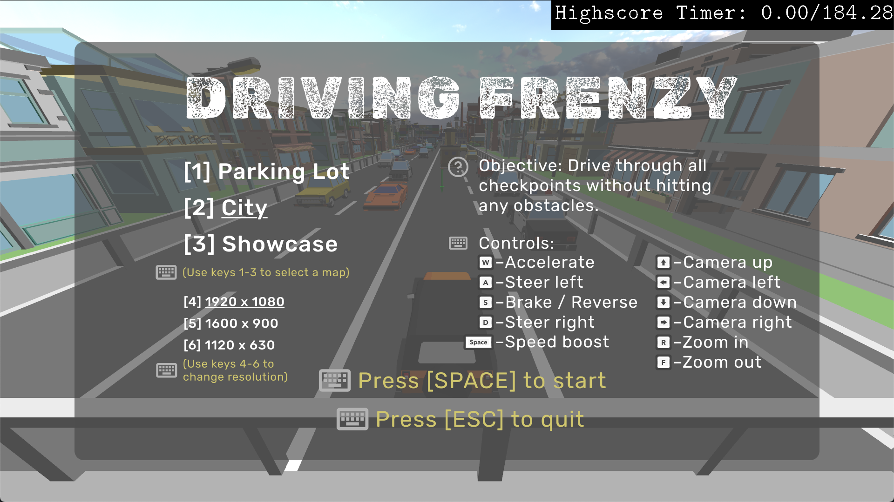
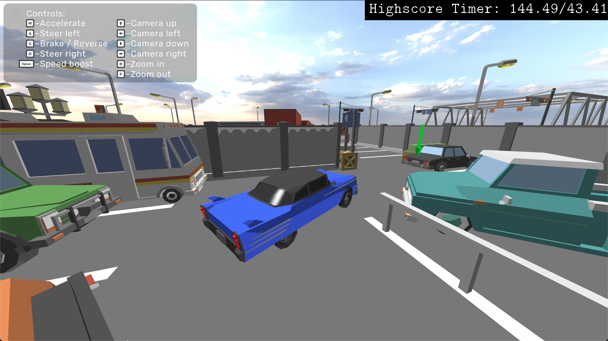
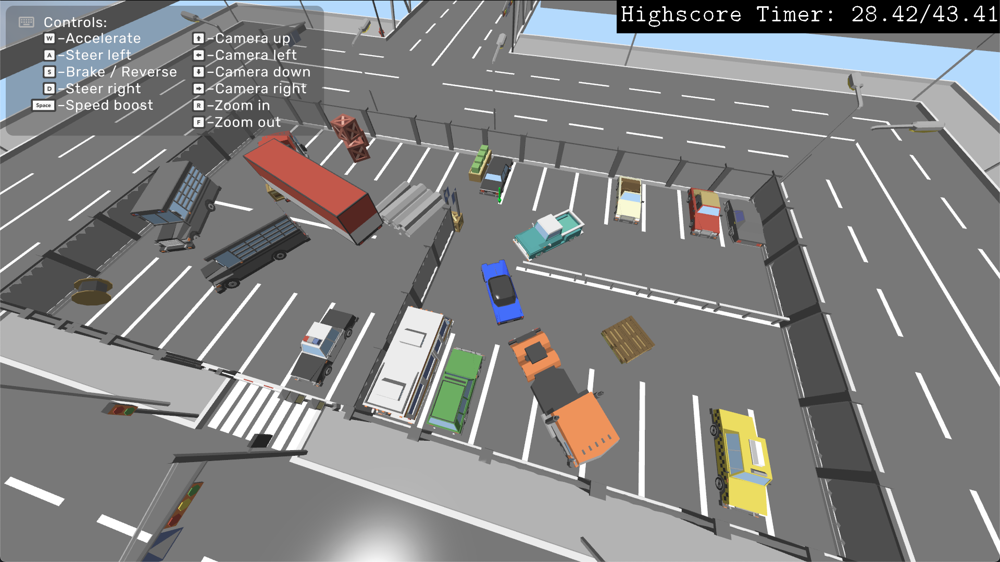
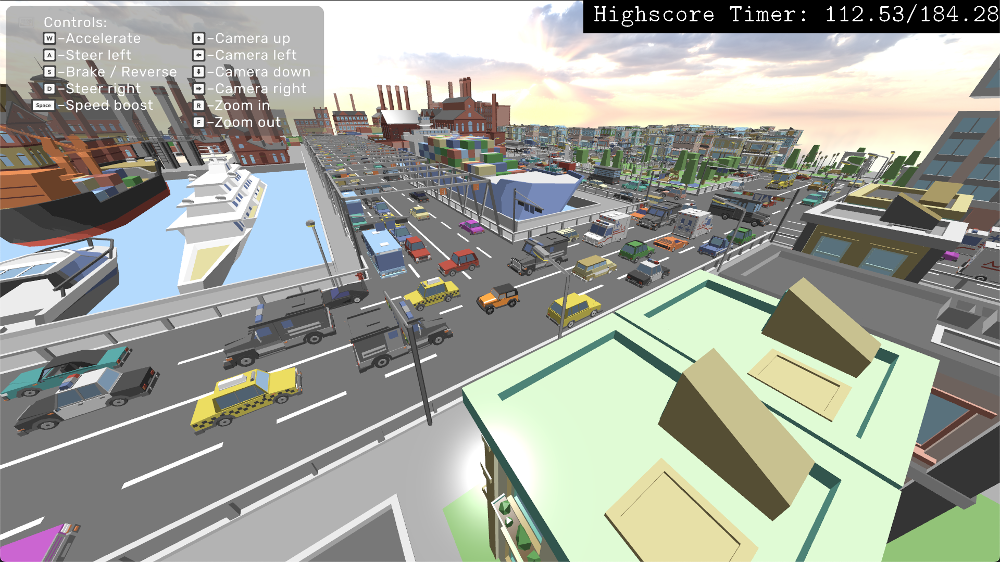
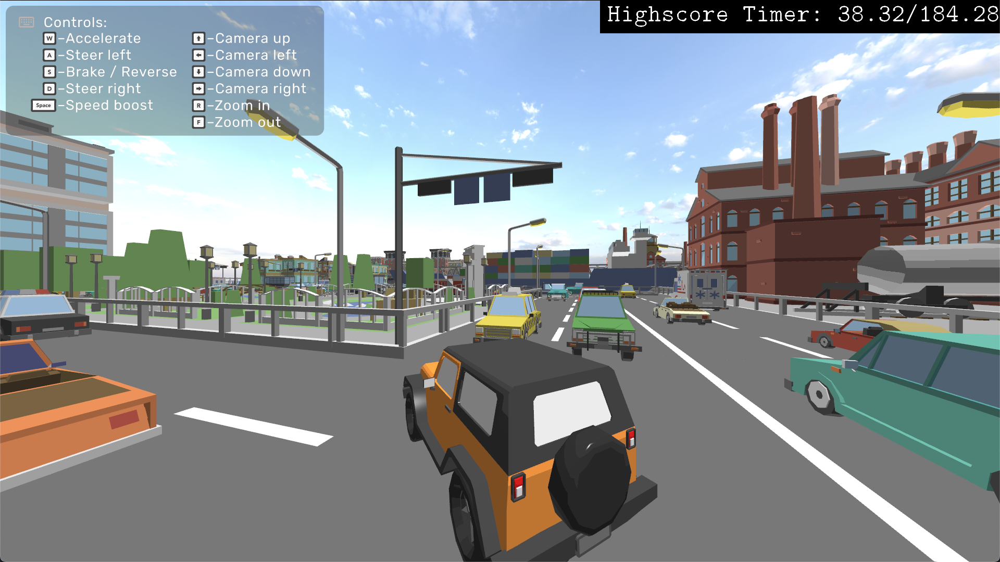
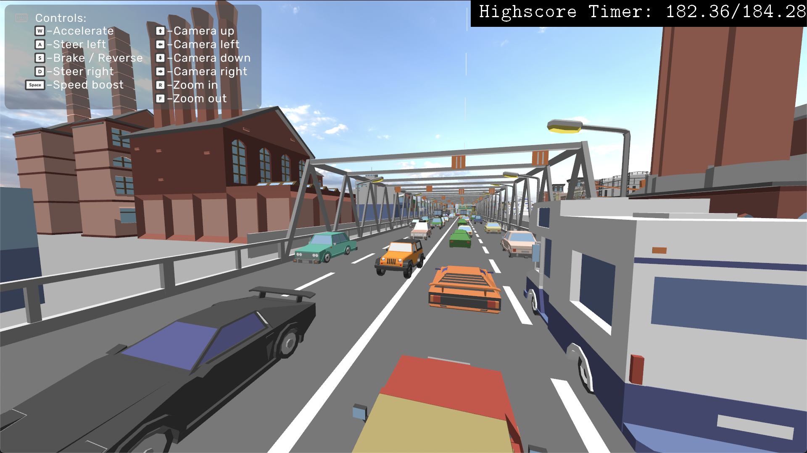
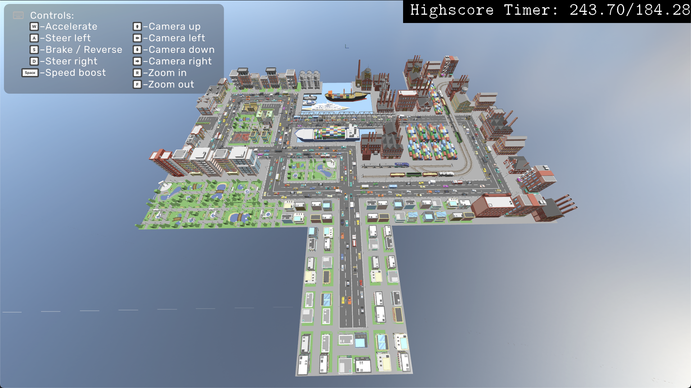
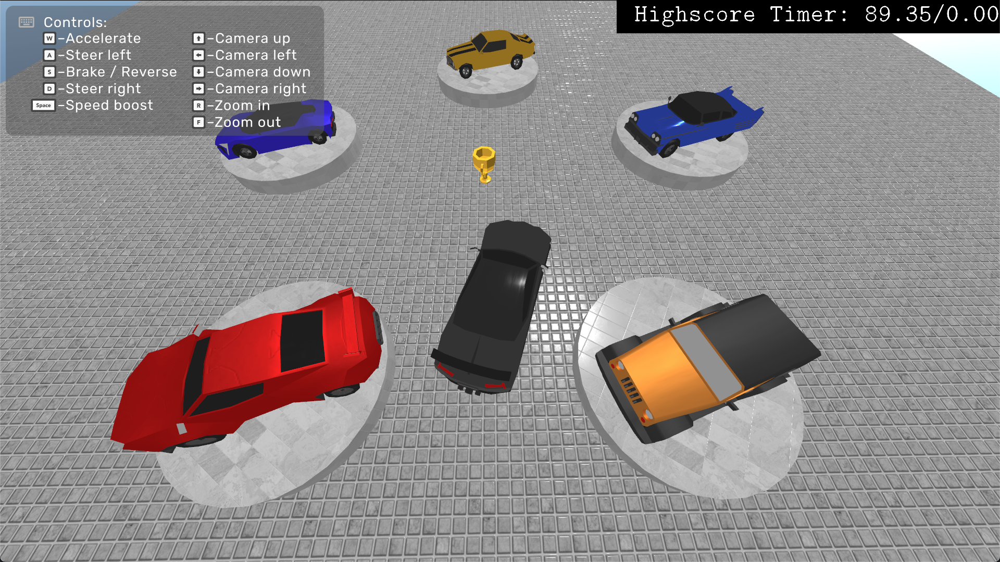
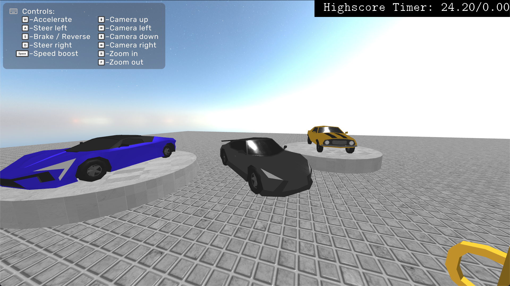

# Driving Frenzy

_A fast, arcade driving game built on a custom **Vulkan** renderer._


<p align="center">
  
</p>


## Overview
### Gameplay
Navigate a car through tight spaces, following a sequence of checkpoints that guide you across each map. Collect the trophy at the end to complete the level. Parked vehicles, railings, and assorted props require precise, careful driving. Clip any obstacle, and the level resets. Master the car handling and optimize your route to perfect your highscore.

### Features
- __Three manually designed maps__, each emphasizing different driving skills.
- __Seemles scene change__ between maps. 
- __Map-dependent cars__ tailored to each environment.
- __Custom HUD and UI__.
- __Adjustable resolution and window size__, with a __resolution-scaled HUD/UI__.
- __Adjusted Phong shader__ for a toon-like look, and a __PBR shader__ in the Showcase level.
- __Car models by [Cosmo Art](https://cosmo-art.itch.io/low-poly-cars)__, with individually rigged wheels for an authentic driving feel.
- __Oriented Bounding Boxes (OBB)__ for precise collision detection.
- __Smooth, player-adjustable camera__ movement.

## Maps
### 1) Parking Lot
A compact course that demands **precise navigation** and **parking maneuvers** around varied obstacles.

|  |  |
|---|---|
| Close-up | Overview |

### 2) City
A large, **hand-crafted city** spanning **suburbs**, **city centre**, **harbour**, and **industrial** districts. Drive across the **entire city**, threading through **dense traffic** and **busy streets**.

|  |  |
|---|---|
| Wide overview | Street-level |

|  |  |
|---|---|
| Bridge crossing | Map view |

### 3) Showcase
Level **showcasing a PBR shader** with high-resolution materials. Features five [Cosmo Art](https://cosmo-art.itch.io/low-poly-cars) cars on rotating **pedestals**, each with a distinct look and PBR properties.

|  |  |
|---|---|
| Pedestal lineup | Material detail |


## Per-Map Statistics

| Map         | Estimated Time | Best Time | Checkpoints | Collisions | Instances |
|-------------|----------------|-----------|-------------|------------|-----------|
| Parking Lot | 01:10.00       | 00:35.46  | 20          | 54         | 103       |
| City        | 04:10.00       | 02:55.66  | 137         | 620        | 947       |
| Showcase    | —              | —         | —           | —          | 52        |


## Controls
- **W / S** – Accelerate / Brake  
- **A / D** – Steer  
- **Space** – Speed Boost / Start / Continue  
- **Esc** – Pause / Back / Quit (in menus)
- **1 / 2 / 3** – Switch menu level  
- **4 / 5 / 6** – Change HUD resolution preset (1920 / 1600 / 1120)
- **Arrow Keys** - Move camera 
- **R / F** - Adjust camera zoom


## Build & Run
### Prerequisites
- Vulkan SDK **1.3+**
- CMake **3.20+**
- macOS: MoltenVK (via Vulkan SDK)

### Configure
```bash
mkdir -p build && cd build
cmake -DCMAKE_BUILD_TYPE=Release ..
cmake --build . -j
```